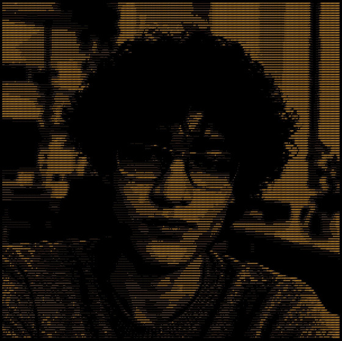

<div align="center">

</div>

<table>
  <tr>
    <td width="35%" valign="top" align="center">
      
    </td>
    <td width="66%" valign="top">

```text
rahul@github ────────────────────────────────────────────────────────

▸ founding engineer intern @ spreezy.ai 

▸ Focus:      AI & Backend Systems

▸ Languages:  Python · SQL · JavaScript / TypeScript

▸ Techstack:
  FastAPI · PostgreSQL · Docker · AI Agents · React · LLM tooling
──────────────────────────────────────────────────────────────────────
Contact:
  Email:        rahulthk1702@gmail.com
  LinkedIn:     rahul thakur
```
